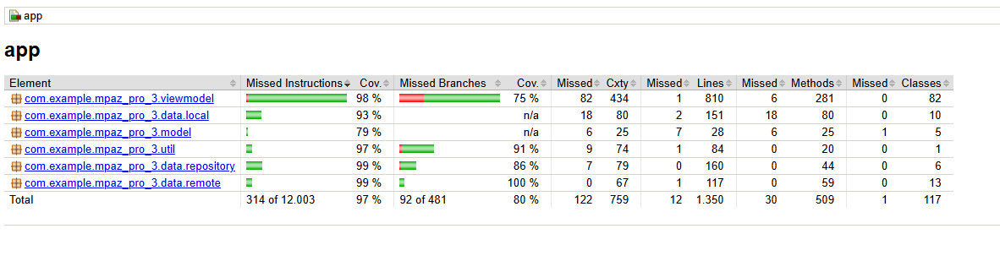
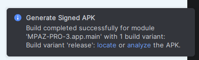
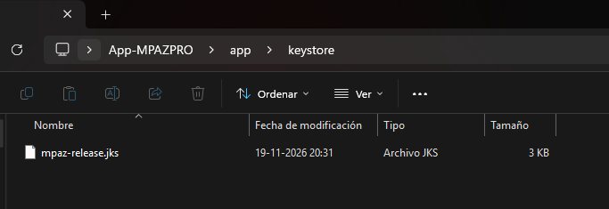

# MPAZ PRO 3.º

App Android de apoyo didáctico para estudiantes de 3.º básico de la Escuela Escritora Marcela Paz.
Organiza una unidad por asignatura (Lenguaje, Matemática, Ciencias Naturales e Historia) en torno a
objetivos de aprendizaje, con perfiles de estudiante, docente y jefatura UTP.

**Integrantes:** Jairo Cid e Isidora Quinteros
**Asignatura:** DSY1105 - Desarrollo de Aplicaciones Móviles, Duoc UC
**Microservicios:** repositorio aparte `MPAZ-PRO-3-microservicios` (ms-contenidos y ms-resultados)

## Funcionalidades

**Ingreso**
- Selección de perfil e inicio de sesión con RUT validado (dígito verificador).
- Estudiantes con PIN (día y mes de nacimiento); docentes y UTP con contraseña.
- Sesión guardada con DataStore.

**Estudiante**
- Asignaturas disponibles según la aprobación de UTP y la asignación del docente.
- Unidad con su objetivo de aprendizaje y un camino de 3 pasos: Aprende, Desafíos y Prueba final.
- Desafíos en 3 niveles con retroalimentación inmediata.
- Al superar los 3 niveles gana un Pokémon (API externa PokeAPI) y lo guarda en **Mi colección**.
- Prueba final con máximo de intentos. Cada intento se envía al microservicio ms-resultados.
- Acceso a las guías que sube el docente.

**Docente**
- Asignación de objetivos y máximo de intentos (se guarda en ms-contenidos).
- **CRUD de preguntas** (crear, ver, editar y eliminar) conectado a ms-contenidos, con formulario validado.
- Imagen de apoyo desde la galería y subida de guías desde los archivos del dispositivo.
- Informe pedagógico con los resultados de todo el curso (desde ms-resultados), validación docente,
  reinicio de intentos de un estudiante y descarga en CSV.

**Jefatura UTP**
- Revisión de contenidos: aprobar o pedir cambios con observación obligatoria (se guarda en ms-contenidos).

**General**
- Room guarda una copia local: si los microservicios no responden, la app sigue funcionando y muestra un aviso.
- Formularios validados, animaciones y diseño adaptable a celular y tablet.

## Endpoints

### Microservicios propios (Spring Boot + PostgreSQL)

Desde el emulador la app usa `10.0.2.2` (equivale al `localhost` del computador).

| Microservicio | Método | Endpoint | Uso en la app |
|---|---|---|---|
| ms-contenidos (8081) | GET | `/api/objetivos` | Sincronizar objetivos al abrir la app |
| ms-contenidos | GET | `/api/objetivos/{id}` | Consultar un objetivo |
| ms-contenidos | POST | `/api/objetivos` | Crear un objetivo (Postman) |
| ms-contenidos | PUT | `/api/objetivos/{id}` | Asignar, aprobar, observar y validar informe |
| ms-contenidos | DELETE | `/api/objetivos/{id}` | Eliminar un objetivo (Postman) |
| ms-contenidos | GET | `/api/preguntas?objetivoId=` | Listar preguntas |
| ms-contenidos | GET | `/api/preguntas/{id}` | Consultar una pregunta |
| ms-contenidos | POST | `/api/preguntas` | Docente crea una pregunta |
| ms-contenidos | PUT | `/api/preguntas/{id}` | Docente edita una pregunta |
| ms-contenidos | DELETE | `/api/preguntas/{id}` | Docente elimina una pregunta |
| ms-resultados (8082) | GET | `/api/intentos?objetivoId=&rut=` | Informe del curso |
| ms-resultados | GET | `/api/intentos/{id}` | Consultar un intento |
| ms-resultados | POST | `/api/intentos` | Estudiante entrega la prueba final |
| ms-resultados | DELETE | `/api/intentos/{id}` | Docente reinicia los intentos de un estudiante |

### API externa

| API | Método | Endpoint | Uso en la app |
|---|---|---|---|
| PokeAPI | GET | `https://pokeapi.co/api/v2/pokemon/{id}` | Premio al terminar los desafíos (nombre, imagen y tipos) |

Se consume con Retrofit (`data/remote/PokeApi.kt`) y se muestra con Coil. No reemplaza ni modifica
los datos de los microservicios.

## Pasos para ejecutar

**1. Base de datos PostgreSQL** (elegir una opción)
- En la nube con Neon (no requiere instalar nada): crear las bases `mpaz_contenidos` y `mpaz_resultados`
  y usar su cadena de conexión en las variables `DB_URL`, `DB_USER` y `DB_PASSWORD`.
- Local: PostgreSQL con las bases `mpaz_contenidos` y `mpaz_resultados` (usuario y clave `postgres`).

**2. Microservicios** (repositorio de microservicios, Java 17)
- Abrir cada carpeta (`ms-contenidos` y `ms-resultados`) en IntelliJ IDEA, que trae Maven incluido,
  y ejecutar la clase `MsContenidosApplication` (puerto 8081) y `MsResultadosApplication` (puerto 8082).
- Con Maven instalado también se puede usar `mvn spring-boot:run` dentro de cada carpeta.
- Si no hay PostgreSQL disponible, se puede usar el perfil de respaldo con H2: `--spring.profiles.active=h2`.

**3. App**
1. Abrir este proyecto en Android Studio y esperar la sincronización de Gradle.
2. Ejecutar en un emulador con Android 9 o superior (con los microservicios encendidos).
3. Si la app estaba instalada de una versión anterior, desinstalarla primero (la base local cambió a la versión 4).

Usuarios ficticios: estudiante `25418732-1` / PIN `0703`, docente `15842391-K` / `docente123`,
UTP `13276054-3` / `utp12345`.

## Pruebas unitarias y cobertura

Kotest, MockK y JUnit 5 en `app/src/test`. Cubren los ViewModel, los repositorios, los mapeos y las validaciones.

```
gradlew testDebugUnitTest        (ejecuta las pruebas)
gradlew jacocoTestReport         (reporte en app/build/reports/jacoco/jacocoTestReport/html/index.html)
```

El reporte mide la lógica de la app. No incluye las pantallas Compose, el tema, la navegación,
el código generado por Room ni los clientes de red.



## APK firmado

- Keystore: `app/keystore/mpaz-release.jks` (alias `mpaz`).
- Configuración: `keystore.properties` y `signingConfigs` en `app/build.gradle.kts`.
- Generar: **Build > Generate Signed App Bundle / APK > APK**, usando el keystore anterior y la variante `release`.
  También con `gradlew assembleRelease` (queda en `app/build/outputs/apk/release/app-release.apk`).
- APK entregado: `app/release/app-release.apk`.





## Tecnologías

Kotlin, Jetpack Compose, Material 3, MVVM, Navigation Compose, Room, DataStore, corrutinas,
Retrofit, OkHttp, Coil, Kotest, MockK y JaCoCo. Microservicios con Spring Boot, JPA y PostgreSQL.

## Estructura

```
data/local/        Room (entidades y DAO)
data/remote/       Retrofit: APIs, DTO y mapeos
data/repository/   Repositorios (combinan servidor y Room)
data/preferences/  DataStore
navigation/        Rutas y navegación
ui/                Pantallas, componentes y tema
util/              Validaciones, archivos y conexión a internet
viewmodel/         ViewModels de cada pantalla
```
